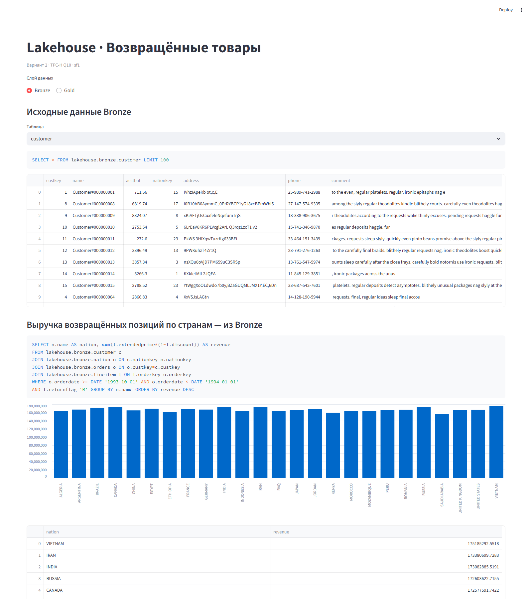
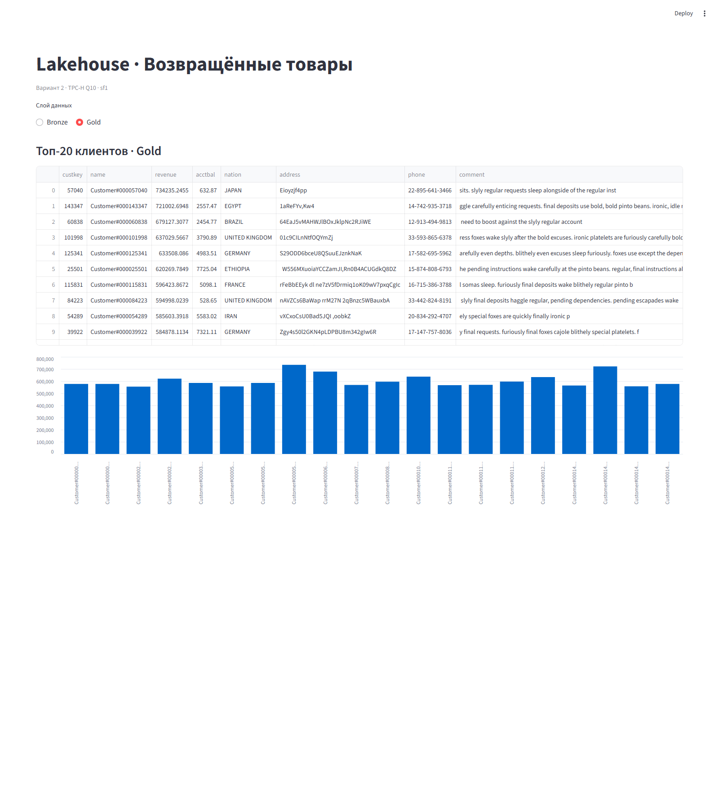

# Отчёт по практической работе №1

## 1. Вариант и масштаб

| Поле | Значение |
| --- | --- |
| ФИО (как в VK Education) | Котяева Арина Руслановна |
| Вариант (запрос) | 2 — Q10 Returned Item Reporting |
| Масштаб | sf1 |
| Почему выбран такой масштаб | sf1 даёт около 6 млн позиций заказов: достаточно для учебного сравнения сжатия и посильно для локального Docker с 8 ГБ памяти. Это не промышленный нагрузочный стенд. |

## 2. Поднятые сервисы — и почему именно они

| Сервис | Роль в стеке | Почему именно он |
| --- | --- | --- |
| MinIO | S3-совместимое хранилище файлов Iceberg | Показывает работу с объектным хранилищем локально через стандартный S3 API; данные доступны независимо от SQL-движка. |
| PostgreSQL 17 | Служебная БД Lakekeeper | Транзакционная БД поддерживается каталогом. Аналитические данные находятся в MinIO, не в PostgreSQL. |
| Lakekeeper 0.13.1 | Iceberg REST Catalog | Открытый REST API отделяет каталог от вычислений; поддерживается Trino без отдельного Hive Metastore. |
| Trino 484 | SQL: генерация TPC-H, загрузка, ELT, аналитика | Есть коннекторы TPC-H и Iceberg и поддержка S3. SQL достаточно для всех преобразований; дополнительный вычислительный кластер не нужен. |
| Streamlit 1.50.0 + Trino client | Дополнительный инструмент BI: таблицы и графики | Интерактивный интерфейс с явно показанным SQL, без отдельной БД пользователей и фоновых workers. В отличие от Superset, визуализации задаются кодом; для учебной задачи это проще. |

### Скрипты развёртывания

Реальная полная конфигурация — [compose.yaml](compose.yaml), настройки — [config/trino](config/trino). JSON является допустимым подмножеством YAML; Docker Compose читает такой файл. MinIO и Lakekeeper закреплены digest образов. Идентификаторы остальных реально запущенных образов сохранены в `results/images.json`.

```powershell
# Хранилище, миграция БД, каталог, SQL-движок
docker compose up -d postgres minio lakekeeper trino
# Создание бакета и warehouse lab1
python scripts/setup.py
# Загрузка, ELT, бенчмарк и проверки
python scripts/run_lab.py --scale sf1 --repeats 5
# Дополнительный BI-инструмент, после замеров
docker compose up -d --build bi
# Фактически запущенные сервисы
docker compose ps
```

Стек использует отдельную сеть и собственные именованные тома. Старые остановленные контейнеры пользователя не изменялись. Сервисы доступны только на 127.0.0.1; пароли в конфигурации учебные. Heap Trino — 3 ГБ, лимит памяти одного запроса — 1 ГБ. При первом запуске возникла ошибка ABANDONED_TASK из-за расхождения часов внутри Docker; после установки `task.client.timeout=1h` запуск повторён. При загрузке также возникла ошибка Iceberg о движении времени назад; пайплайн продолжен с уже готовых таблиц. Неудачные попытки не вошли в измерения. Параметры хоста и Docker сохранены в `results/hardware.json`; замеры времени выполнены монотонным таймером Windows на клиенте.

```text
NAME                    IMAGE                                                                                                COMMAND                  SERVICE      CREATED                  STATUS                    PORTS
lab1-q10-bi-1           lab1-q10-bi                                                                                          "streamlit run app.p…"   bi           Less than a second ago   Up 2 minutes              127.0.0.1:18088->8501/tcp
lab1-q10-lakekeeper-1   quay.io/lakekeeper/catalog@sha256:9dad9f2df9cb5cb0b6d75ec94379e0de9f5a2029e817213a68f2afd8691615dc   "/home/nonroot/lakek…"   lakekeeper   11 minutes ago           Up 17 minutes (healthy)   127.0.0.1:18181->8181/tcp
lab1-q10-minio-1        quay.io/minio/minio@sha256:14cea493d9a34af32f524e538b8346cf79f3321eff8e708c1e2960462bd8936e          "/usr/bin/docker-ent…"   minio        11 minutes ago           Up 17 minutes             127.0.0.1:19000->9000/tcp, 127.0.0.1:19001->9001/tcp
lab1-q10-postgres-1     postgres:17                                                                                          "docker-entrypoint.s…"   postgres     11 minutes ago           Up 17 minutes (healthy)   5432/tcp
lab1-q10-trino-1        trinodb/trino:484                                                                                    "/usr/lib/trino/bin/…"   trino        Less than a second ago   Up 2 minutes (healthy)    127.0.0.1:18080->8080/tcp

```

## 3. Разбор запроса — какие данные нужны

| Таблица TPC-H | Нужные колонки | Использование |
| --- | --- | --- |
| customer | custkey, name, acctbal, nationkey, address, phone, comment | custkey — связь и группировка; nationkey — связь со страной; остальные поля — группировка и вывод. |
| orders | orderkey, custkey, orderdate | orderkey/custkey — связи; orderdate — фильтр IV квартала 1993. |
| lineitem | orderkey, linenumber, extendedprice, discount, returnflag | orderkey — связь; returnflag — фильтр R; extendedprice*(1-discount) — выручка. linenumber дополнительно оставлен для проверки уникальности позиции. |
| nation | nationkey, name | nationkey — связь с customer; name — название страны в выводе. |


Границы дат: `orderdate >= DATE '1993-10-01' AND orderdate < DATE '1994-01-01'`. Это дата заказа, а не дата возврата. К исходной сортировке добавлен `custkey` как второй ключ для воспроизводимого порядка при равных суммах. Типы исходных денежных полей TPC-H сохранены. Агрегаты DOUBLE сверяются с допуском `rel_tol=1e-10, abs_tol=1e-6`, поскольку порядок сложения в распределённом плане может отличаться.

## 4. Медальон — решения по каждому слою

### Bronze (сырой)

| Таблица | Колонки | Строк | Вес, МБ | Формат | Сжатие | Партиционирование | Обоснование |
| --- | --- | --- | --- | --- | --- | --- | --- |
| bronze.customer | custkey, name, acctbal, nationkey, address, phone, comment | 150,000 | 7.587960 | PARQUET | ZSTD | нет | Нужные исходные колонки без фильтрации строк; колоночное чтение и компактное хранение. |
| bronze.orders | orderkey, custkey, orderdate | 1,500,000 | 6.980610 | PARQUET | ZSTD | нет | Нужные исходные колонки без фильтрации строк; колоночное чтение и компактное хранение. |
| bronze.lineitem | orderkey, linenumber, extendedprice, discount, returnflag | 6,001,215 | 33.498227 | PARQUET | ZSTD | нет | Нужные исходные колонки без фильтрации строк; колоночное чтение и компактное хранение. |
| bronze.nation | nationkey, name | 25 | 0.000606 | PARQUET | ZSTD | нет | Нужные исходные колонки без фильтрации строк; колоночное чтение и компактное хранение. |

### Silver (очищенный)

| Таблица | Колонки | Строк | Вес, МБ | Формат | Сжатие | Партиционирование | Обоснование |
| --- | --- | --- | --- | --- | --- | --- | --- |
| silver.customer_dim | custkey, name, acctbal, nation, address, phone, comment, name_normalized, address_normalized, comment_normalized | 150,000 | 13.220831 | PARQUET | ZSTD | нет | Подготовленные данные повторно используются; формат совместим с Bronze и SQL-движком. |
| silver.returned_lines | custkey, orderkey, linenumber, orderdate, extendedprice, discount, revenue | 114,705 | 1.779834 | PARQUET | ZSTD | нет | Подготовленные данные повторно используются; формат совместим с Bronze и SQL-движком. |


`customer_dim` обогащает клиентов названиями стран; `trim`-нормализация записана в дополнительные колонки. Исходный текст сохранён для точного соответствия Q10. `returned_lines` отбирает позиции нужного квартала с флагом возврата, проверяет диапазоны цены/скидки и вычисляет выручку позиции. Дубликаты не удаляются молча: отдельно проверено их отсутствие, чтобы не изменить суммы. Данные TPC-H изначально корректны; искусственные ошибки не добавлялись.

Партиционирования нет: проекция на sf1 сравнительно небольшая, а разбиение по месяцам создало бы много мелких файлов. Silver уже ограничен одним кварталом; Gold содержит только 20 строк. На больших объёмах можно отдельно проверить `month(orderdate)`, но здесь выигрыш без измерения не заявляется.

### Gold (витрина)

| Таблица | Колонки | Строк | Вес, МБ | Формат | Сжатие | Партиционирование | Обоснование |
| --- | --- | --- | --- | --- | --- | --- | --- |
| gold.returned_customers_top20 | custkey, name, revenue, acctbal, nation, address, phone, comment | 20 | 0.003226 | PARQUET | ZSTD | нет | 20 строк не требуют разбиения; единый формат упрощает эксплуатацию. |


Gold материализована из Silver. Порядок строк хранения не гарантирован: просмотр использует `ORDER BY revenue DESC, custkey`. Результат: [results/gold_top20.csv](results/gold_top20.csv).

Размер — точная сумма `file_size_in_bytes` из Iceberg `$files` текущего снимка, то есть активных файлов данных в MinIO. 1 МБ = 1 000 000 байт. Метаданные JSON/Avro и старые снимки в эту метрику не входят; она не равна полному размеру Docker-тома. Число строк получено через `SELECT count(*)`; `SHOW STATS` не использовался как точный размер файлов.

## 5. Тесты производительности

Четыре независимые схемы Bronze содержат одинаковые проекции из одного `tpch.sf1`; отличаются только формат и кодек. Сравнивается Q10 напрямую по Bronze. Запрос по Gold не подходит для оценки сжатия Bronze, так как читает уже готовый результат.

После загрузки проверен результат каждого варианта и выполнен отдельный прогрев. Затем проведено пять измеряемых запусков каждого варианта с чередованием схем, перемешанным с фиксированным seed 20261016. Основная метрика — медиана; min/max показывают разброс. Время измерено `perf_counter` на клиенте от отправки SQL до получения всех строк, включая планирование, чтение, вычисление и сетевые накладные расходы. Кэш ОС/MinIO не очищался: это повторные запросы, а не холодное чтение. Сборка BI завершена до измеряемых запусков; само BI-приложение тогда не работало.

Время записи — сумма четырёх CTAS, каждый выполнялся один раз. Оно включает генерацию TPC-H, сериализацию, сжатие и S3-запись. Порядок загрузки фиксирован (GZIP, ZSTD, ORC/ZSTD, NONE); прогрев JVM может влиять на запись, поэтому по этой метрике нельзя изолированно судить о скорости кодека.

| Формат | Сжатие Bronze | Медиана Q10, с | Min–max, с | Размер Bronze, МБ | Запись, с | Повторов |
| --- | --- | --- | --- | --- | --- | --- |
| PARQUET | GZIP | 1.5543 | 1.3458–1.5932 | 48.220 | 18.933 | 5 |
| PARQUET | ZSTD | 1.1906 | 1.1135–1.4216 | 48.067 | 10.530 | 5 |
| ORC | ZSTD | 1.2863 | 1.2492–1.4997 | 53.098 | 7.690 | 5 |
| PARQUET | NONE | 1.1776 | 1.0705–1.3004 | 139.276 | 7.764 | 5 |

Самый компактный вариант этого запуска — **PARQUET/ZSTD**, 48.067 МБ. Минимальная медиана Q10 — **PARQUET/NONE**, 1.1776 с. Parquet/ZSTD уменьшил размер относительно Parquet/NONE в 2.90 раза. Parquet/ZSTD выбран для слоёв как компактное колоночное представление с поддержкой всего стека; это не утверждение о его универсальном превосходстве. Один компьютер и пять повторов не позволяют распространить результат на любые объёмы и нагрузки.

Доказательства: [benchmark_runs.json](results/benchmark_runs.json), [benchmark.csv](results/benchmark.csv), [writes.json](results/writes.json), [журнал успешно выполненного SQL с query ID](results/queries.jsonl).

### Проверки корректности

| Проверка | Результат |
| --- | --- |
| customer_duplicates | 0 |
| order_duplicates | 0 |
| line_duplicates | 0 |
| invalid_money | 0 |
| orphan_orders | 0 |
| orphan_lines | 0 |
| orphan_nations | 0 |
| gold_matches_tpch | True |
| all_bronze_variants_match_tpch | True |


Все четыре варианта Bronze и итоговая Gold сопоставлены с исходным Q10 непосредственно по TPC-H: 20 строк, порядок и все выходные поля. Нулевые значения в проверках означают отсутствие нарушений, а не отсутствие проверяемых строк.

## 6. Часть 2 — осмысление и инструменты

### 6.1. Понять и объяснить

| Вопрос | Ответ |
| --- | --- |
| Зачем нужны большие данные и lakehouse, а не обычная БД/хранилище? | При большом объёме аналитики полезно разделить хранение и вычисления: S3 хранит открытые файлы, разные движки используют общий каталог, Iceberg добавляет согласованные снимки и изменение схемы. PostgreSQL проще для небольших данных и точечных транзакций. Lakehouse выбирают по нагрузке, а не потому, что он всегда лучше. |
| Пример schema evolution на Silver | В silver.evolution_demo создано 3 строки; добавлена колонка source VARCHAR, затем переименована в data_source. Старых строк осталось 3, новая колонка у них NULL. SQL: sql/08_schema_evolution.sql; фактические до/после: results/schema_evolution.json. |
| Пример восстановления из снапшота | Сохранён снимок 875890668398002844. После INSERT стало 4 строки; time travel прочитал 3, rollback восстановил 3. Проверка выполнена на отдельной Silver-таблице, основная витрина не менялась. |


```sql
-- Актуальный ID перед своей демонстрацией:
SELECT snapshot_id FROM lakehouse.silver."evolution_demo$snapshots"
ORDER BY committed_at DESC LIMIT 1;
-- Фактически использованный ID этого запуска:
SELECT * FROM lakehouse.silver.evolution_demo
FOR VERSION AS OF 875890668398002844;
ALTER TABLE lakehouse.silver.evolution_demo
EXECUTE rollback_to_snapshot(875890668398002844);
```

Полный выполненный пример с INSERT — [sql/09_time_travel.sql](sql/09_time_travel.sql). Скрипт определяет ID до изменения данных. Откат снимка содержимого не следует считать универсальным откатом схемы; здесь откатывается INSERT после изменения схемы.

### 6.2. Подключить инструмент к lakehouse

| Инструмент | Почему выбран |
| --- | --- |
| Streamlit в отдельном Docker-контейнере | Интерактивный BI-инструмент: выбор исходной таблицы, показ SQL и график непосредственно по Bronze; минимальное число дополнительных сервисов. |


Развёртывание: `docker compose up -d --build bi`. Исходники: [bi/Dockerfile](bi/Dockerfile), [bi/app.py](bi/app.py). Из контейнера подключение идёт к `trino:8080`, каталог `lakehouse`, пользователь `bi`. Адрес на компьютере: http://localhost:18088.

Действия в интерфейсе:

1. Открыть http://localhost:18088, выбрать Bronze.
2. Выбрать customer / orders / lineitem / nation: увидеть SQL и первые 100 исходных строк.
3. Ниже посмотреть график возвращённой выручки по странам: он строится SQL-джойном четырёх Bronze-таблиц с фильтрами Q10.
4. Переключиться на Gold: увидеть топ-20 клиентов и график.

Фактическая проверка приложения через Streamlit AppTest: `results/bi_check.json`. Она запускает UI-код, проверяет выбор таблиц Bronze, агрегат по странам и таблицу Gold, отсутствие ошибок. Это программная проверка интерфейса. Дополнительно интерфейс открыт в реальном headless Edge: выбран Bronze, затем переключён Gold. Скриншоты получены после загрузки данных.





## 7. Выводы

Медальон отделяет исходные данные, их подготовку и результат бизнес-запроса, поэтому каждый шаг можно проверить. Gold содержит 20 клиентов и совпадает с исходным TPC-H Q10. Сжатие уменьшает хранение, но компактность не гарантирует минимального времени SQL: влияют чтение, декодирование, кэш и накладные расходы движка. В этом эксперименте самый компактный вариант — PARQUET/ZSTD, а самый быстрый по медиане — PARQUET/NONE; результат относится к sf1 и данному окружению. Iceberg позволил изменить схему и восстановить содержимое снимка без ручного копирования файлов.

## Источники

- [Lakekeeper: deployment and bootstrap](https://docs.lakekeeper.io/getting-started/)
- [Lakekeeper: query engines](https://docs.lakekeeper.io/docs/latest/engines/)
- [Trino: Iceberg, table properties and snapshots](https://trino.io/docs/current/connector/iceberg.html)
- [Trino: TPC-H connector](https://trino.io/docs/current/connector/tpch.html)
- [Streamlit AppTest](https://docs.streamlit.io/develop/api-reference/app-testing/st.testing.v1.apptest)
